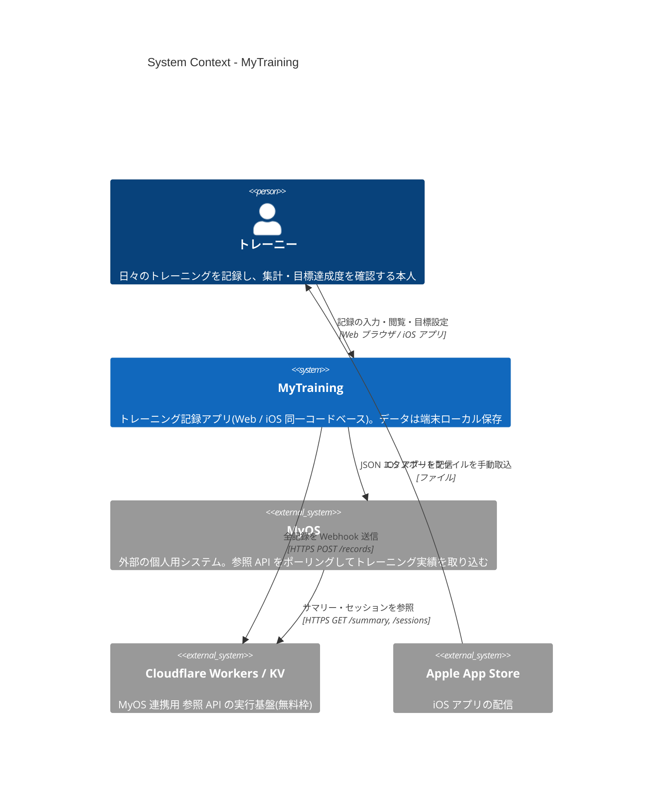
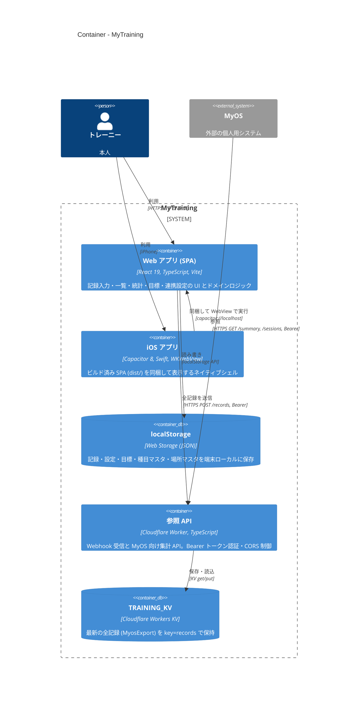
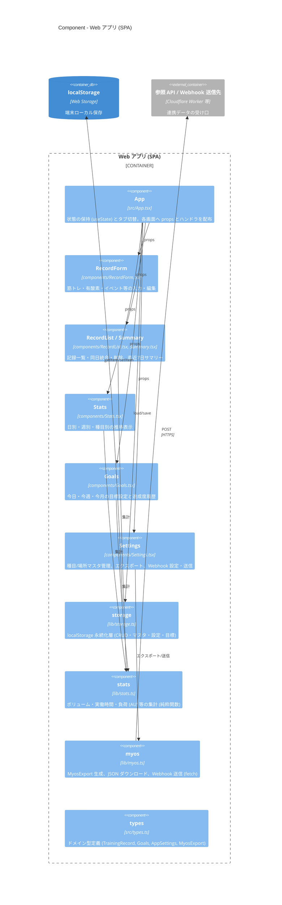
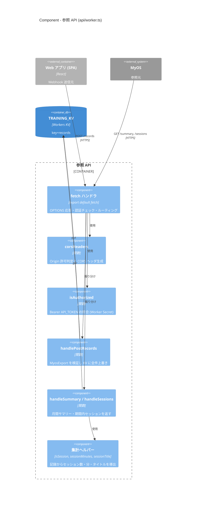
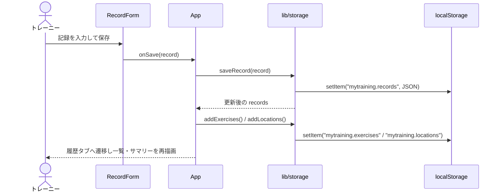
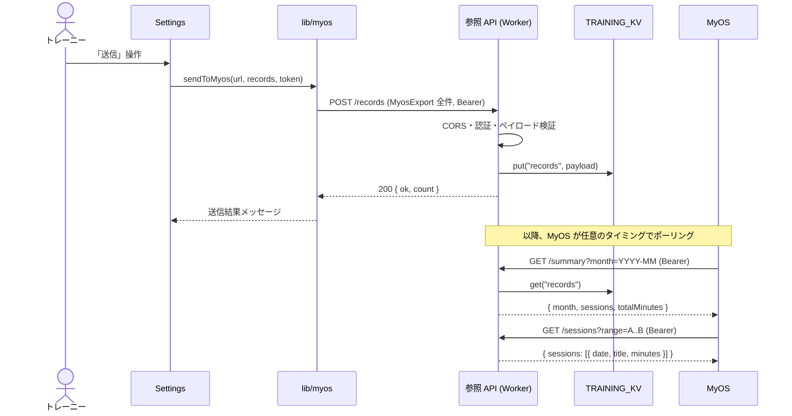
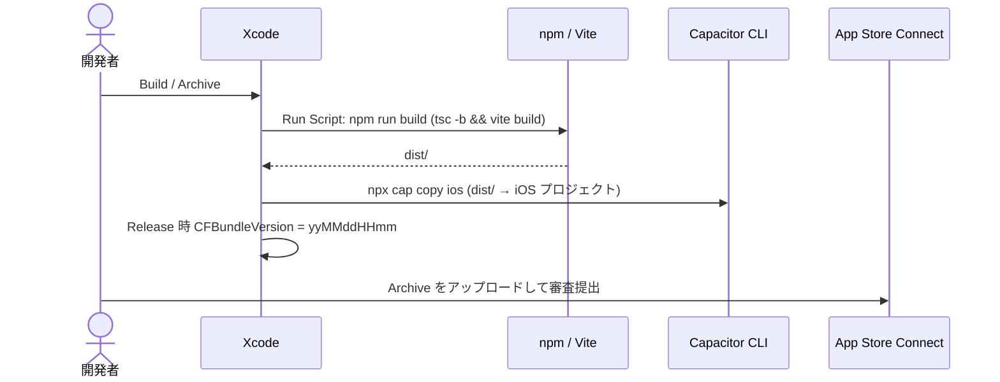

# MyTraining アーキテクチャ(C4 モデル)

本書は C4 モデル(System Context → Container → Component)に沿って MyTraining の構成を示す。
記述はリポジトリ内のコード・設定ファイルに基づく。コードから確認できない点は「未確認」と明記する。
技術選定の理由や代替案は [02_アーキテクチャ設計.md](02_アーキテクチャ設計.md)、データ構造は [03_データモデル.md](03_データモデル.md)、
連携仕様は [04_MyOS連携仕様.md](04_MyOS連携仕様.md) を参照。

## 1. 概要

### 目的

日々のトレーニング(筋トレ・有酸素・イベント参加・体重・疲労度・睡眠・メモ)を記録・集計し、
自己管理システム **MyOS** へ連携して自己理解に役立てる。

### 主な利用者

| 利用者 | 説明 |
|---|---|
| トレーニー(本人) | Web ブラウザまたは iOS アプリで記録を入力・閲覧し、目標を管理する。個人利用を想定(マルチユーザー・ログイン機能なし) |
| MyOS | 外部の個人用システム。参照 API をポーリングしてトレーニング実績を取り込む |

### 技術スタック

| 領域 | 技術 | 根拠 |
|---|---|---|
| 言語 | TypeScript ~6.0 | `package.json` |
| UI | React 19(関数コンポーネント + `useState`、外部状態管理ライブラリなし) | `package.json`, `src/App.tsx` |
| ビルド | Vite 8 + `@vitejs/plugin-react` | `vite.config.ts` |
| リント | oxlint | `.oxlintrc.json` |
| iOS | Capacitor 8(`@capacitor/ios`、Swift Package Manager、iOS 15+) | `capacitor.config.ts`, `ios/App/CapApp-SPM/Package.swift` |
| 永続化 | ブラウザ / WKWebView の localStorage | `src/lib/storage.ts` |
| 連携 API | Cloudflare Workers + Workers KV(`wrangler`) | `api/worker.ts`, `api/wrangler.toml` |
| グラフ | 外部チャートライブラリなし(依存定義に存在しない) | `package.json` |

### 存在しないもの(確認結果)

- 認証基盤・ユーザー管理: なし(Worker のみ共有 Bearer トークンで保護)
- RDB / 本アプリ専用のバックエンドサーバ: なし
- Dockerfile / IaC(Terraform 等): なし(Worker は `wrangler.toml` のみ)
- CI 設定(`.github/workflows` 等): なし
- Web 版のホスティング先: 設計書では GitHub Pages / Cloudflare Pages 等の静的ホスティングを想定しているが、デプロイ設定はリポジトリに無く **未確認**
- MyOS 側の実装: 別リポジトリ(AmonOhno/my-os)のため **未確認**
- `api/wrangler.toml` の KV namespace ID はプレースホルダ(`REPLACE_WITH_YOUR_KV_NAMESPACE_ID`)のままで、実際のデプロイ状況は **未確認**

## 2. Level 1: System Context 図



| 名前 | 種別 | 技術 | 責務 |
|---|---|---|---|
| トレーニー | Person | — | 記録の入力・編集・削除、統計・目標の閲覧、MyOS 連携の設定・実行 |
| MyTraining | Software System(本システム) | React + TypeScript / Capacitor / Cloudflare Worker | トレーニング記録の管理・集計、MyOS 向けデータ提供 |
| MyOS | External System | 未確認(別リポジトリ。CORS 設定から GitHub Pages 配信と推定) | 参照 API からトレーニング実績を取り込む |
| Cloudflare Workers / KV | External System(実行基盤) | Cloudflare Workers, Workers KV | 参照 API(`api/`)のホスティングとデータ保管 |
| Apple App Store | External System | App Store Connect | iOS 版の配布(手順は [05_iOS_AppStore配信手順.md](05_iOS_AppStore配信手順.md)) |

> Webhook 送信先 URL は連携タブで任意に設定できるため、Worker 以外(MyOS 側の任意の受け口)へ直接 POST することも可能。

## 3. Level 2: Container 図



| 名前 | 種別 | 技術 | 責務 |
|---|---|---|---|
| Web アプリ (SPA) | Container(フロントエンド) | React 19, TypeScript, Vite 8 | 全画面 UI、集計ロジック、localStorage 永続化、JSON エクスポート、Webhook 送信。エントリポイントは `index.html` → `src/main.tsx` → `src/App.tsx` |
| iOS アプリ | Container(ネイティブシェル) | Capacitor 8(appId `com.amon.mytraining`)、Swift(`AppDelegate.swift`)、SPM | `dist/` を同梱し WKWebView で SPA を実行。Xcode ビルド時に `npm run build` + `npx cap copy ios` を実行し、Release ではビルド番号(`CFBundleVersion`)を日時で自動付与 |
| localStorage | Container(データストア) | Web Storage | キー `mytraining.records` / `.settings` / `.goals` / `.exercises` / `.locations` に JSON で保存。端末ごとに独立(同期なし) |
| 参照 API | Container(API) | Cloudflare Worker(`api/worker.ts`) | `POST /records`(全件上書き保存)、`GET /summary?month=`、`GET /sessions?range=`。全エンドポイントで `Authorization: Bearer <API_TOKEN>` 必須。CORS は `*.github.io` / `localhost` / `capacitor://localhost` を許可 |
| TRAINING_KV | Container(データストア) | Workers KV | 直近に受信した `MyosExport` 全体を単一キー `records` に保存 |

## 4. Level 3: Component 図

中心コンテナである **Web アプリ (SPA)** と、MyOS 連携の要である **参照 API** の内部構成を示す。

### 4.1 Web アプリ (SPA)



| 名前 | 種別 | 技術 | 責務 |
|---|---|---|---|
| App | Component(ルート) | `src/App.tsx` | records / settings / goals / exercises / locations を `useState` で保持。5 タブ(入力・履歴・統計・目標・連携)の切替。保存時に種目・場所マスタへ自動登録 |
| RecordForm | Component(UI) | `src/components/RecordForm.tsx` | 記録の入力・編集フォーム。ID 採番に `storage.newId`、イベント実働時間・負荷に `stats` を利用 |
| RecordList / Summary | Component(UI) | `src/components/RecordList.tsx`, `Summary.tsx` | 記録一覧(編集・削除・同日統合)、直近7日間サマリー |
| Stats | Component(UI) | `src/components/Stats.tsx` | 日別指標・週別ボリューム・種目別最大値・イベント負荷の推移表示 |
| Goals | Component(UI) | `src/components/Goals.tsx` | 期間別目標の設定、達成度と履歴(直近7日 / 8週 / 6ヶ月) |
| Settings | Component(UI) | `src/components/Settings.tsx` | 種目・場所マスタ管理、JSON エクスポート、Webhook URL / API トークン設定と送信 |
| storage | Component(永続化層) | `src/lib/storage.ts` | localStorage の読み書き、記録の upsert / 削除 / 同日統合、マスタ・設定・目標の保存 |
| stats | Component(ドメインロジック) | `src/lib/stats.ts` | 集計関数群(`recordVolume`, `eventLoad`, `rangeSummary`, `goalPeriodRange` 等) |
| myos | Component(連携) | `src/lib/myos.ts` | `MyosExport`(schemaVersion 1)の生成、Blob ダウンロード、`fetch` による Webhook POST |
| types | Component(型) | `src/types.ts` | ドメイン型。`api/worker.ts` からも参照され、アプリと API で型を共有 |

依存方向は `components → lib → types`。UI から localStorage へ直接アクセスせず、`App` 経由で `storage` を呼ぶ(`RecordForm` の `newId` のみ例外的に直接 import)。

### 4.2 参照 API(Cloudflare Worker)



| 名前 | 種別 | 技術 | 責務 |
|---|---|---|---|
| fetch ハンドラ | Component(エントリポイント) | Workers `fetch` | CORS プリフライト応答、認証失敗時 401、パス/メソッドでのルーティング、該当なし 404 |
| corsHeaders | Component | TypeScript 関数 | `https://*.github.io` / `http://localhost:*` / `capacitor://localhost` のみ許可 |
| isAuthorized | Component | TypeScript 関数 | `Authorization: Bearer <API_TOKEN>` を照合。`API_TOKEN` 未設定時は常に拒否 |
| handlePostRecords | Component | TypeScript 関数 | `source === 'mytraining'` と `records` 配列を検証し、KV に上書き保存 |
| handleSummary / handleSessions | Component | TypeScript 関数 | `month=YYYY-MM` / `range=YYYY-MM-DD..YYYY-MM-DD` を検証し集計結果を返す |
| 集計ヘルパー | Component | TypeScript 関数 | 旧形式データ(`minutes`、`events` なし)にも耐える導出ロジック |

## 5. 主要なデータフロー

### 5.1 記録の入力と保存



### 5.2 MyOS 連携(Webhook 送信 → MyOS が参照)



### 5.3 iOS ビルドと配信



## 6. ディレクトリ構成

```
mytraning/
├── index.html              # SPA の HTML エントリ(/src/main.tsx を読み込む)
├── package.json            # 依存・npm スクリプト(dev / build / lint / preview)
├── vite.config.ts          # Vite 設定(React プラグイン)
├── tsconfig*.json          # TypeScript 設定(app / node のプロジェクト参照)
├── .oxlintrc.json          # oxlint 設定
├── capacitor.config.ts     # Capacitor 設定(appId, webDir=dist)
├── src/                    # Web アプリ本体(Web / iOS 共通)
│   ├── main.tsx            # React のマウント
│   ├── App.tsx             # ルート: 状態保持・タブ切替
│   ├── index.css           # 全体スタイル
│   ├── types.ts            # ドメイン型(api/ からも参照)
│   ├── components/         # 画面コンポーネント(RecordForm, RecordList, Summary, Stats, Goals, Settings)
│   └── lib/                # ドメインロジック(storage: 永続化 / stats: 集計 / myos: 連携)
├── api/                    # MyOS 連携用 参照 API(Cloudflare Worker)
│   ├── worker.ts           # エンドポイント実装
│   ├── wrangler.toml       # Worker 設定・KV バインディング
│   └── tsconfig.json
├── ios/                    # Capacitor が生成した iOS(Xcode)プロジェクト
│   ├── App/App/            # AppDelegate.swift, Info.plist, Storyboard
│   ├── App/App.xcodeproj/  # Xcode プロジェクト(Web 再ビルド・ビルド番号付与の Run Script を含む)
│   └── App/CapApp-SPM/     # Capacitor 依存の Swift Package(CLI 管理)
└── docs/                   # 要件定義・設計・データモデル・連携仕様・配信手順・本書
```
